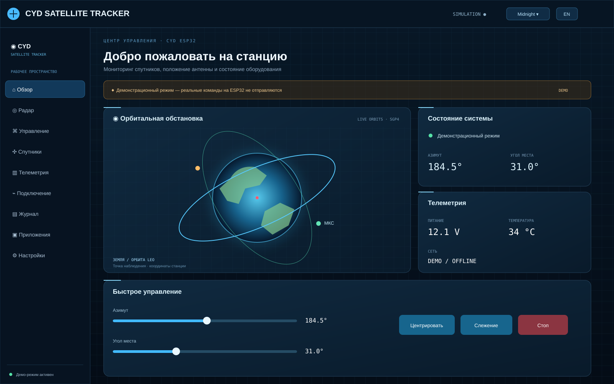
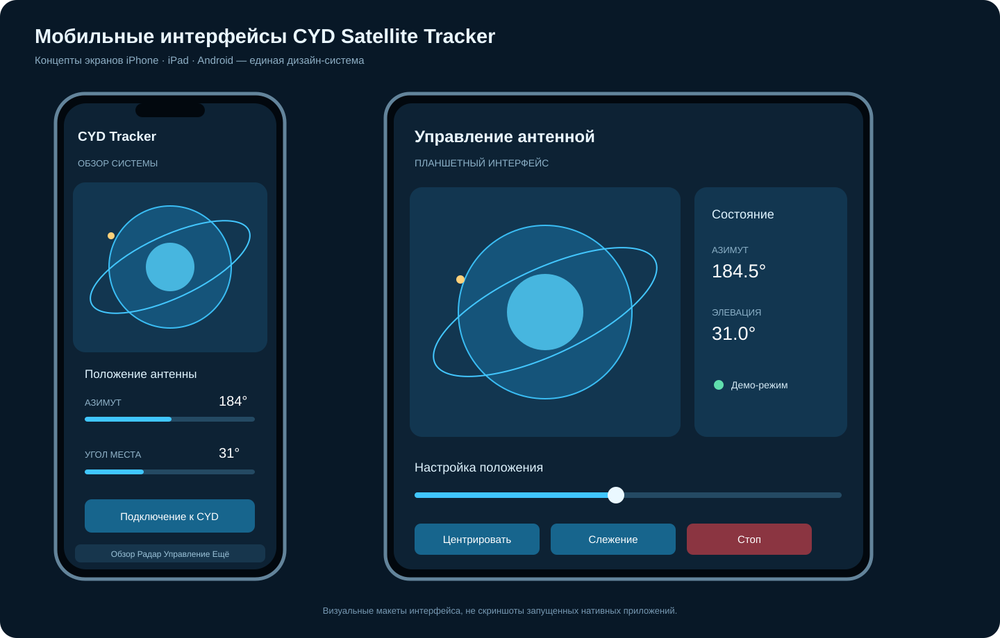

# CYD Satellite Tracker

[🌐 Открыть сайт CYD Satellite Tracker](https://cyd-satellite-tracker.pages.dev)

Демонстрационный веб-интерфейс проекта двухосевого спутникового ротатора на CYD ESP32-2432S028R.

## Иллюстрации проекта

**Главная панель и орбитальная обстановка**



**Каталог спутников — изображения, используемые в опубликованном сайте**

| МКС | NOAA 19 | AO-91 |
|---|---|---|
|  |  |  |

**Концепты мобильных интерфейсов**



Полная [галерея сайта и мобильных интерфейсов](docs/screenshots/README.md).

## Интерфейс версии 1.1

Одностраничная адаптивная панель с девятью разделами:
- **Обзор** — орбитальная иллюстрация, выбранный спутник, положение осей, состояние системы и последние события.
- **Радар** — условное положение спутников на небесной сфере.
- **Управление** — интерактивные ползунки азимута 0–360° и угла места 0–90°, центрирование, наведение и демонстрационная остановка.
- **Спутники** — каталог МКС, NOAA 19 и AO-91 с примерами частот.
- **Телеметрия** — демонстрационные напряжение, токи, температура, Wi-Fi и нагрузка.
- **Подключение** — макет сетевых параметров CYD и предлагаемая архитектура связи.
- **Журнал** — события демонстрационной сессии, очистка журнала.
- **Приложения** — концепт интерфейса для iPhone, iPad и Android.
- **Настройки** — переключение русского и английского языка, описание режима.

## Актуальный каталог спутников

- Веб-каталог загружает открытые орбитальные элементы CelesTrak (GP/TLE), позволяет искать спутники и рассчитывать азимут/угол места по координатам станции.
- [Описание источников и расчётов](docs/satellites/README.md)
- Веб-прогноз пролётов на 12/24/48 часов: AOS, LOS, азимуты и максимум угла места с настраиваемым порогом.
- [Flutter-сервис прогноза пролётов](apps/flutter/lib/features/satellites/domain/satellite_pass_predictor.dart) — доменная логика с интерфейсом для SGP4-адаптера.
- [Flutter: модуль загрузки каталога](apps/flutter/README.md)

Важно: сайт пока остаётся демонстрационным пультом. Перенос углов меняет только ползунки; управление реальными двигателями не реализовано. Flutter-репозиторий данных добавлен как исходный модуль, но полноценные мобильные приложения и SGP4-расчёт в Dart ещё предстоит собрать и интегрировать.

## Скриншоты и интерфейсы

- [Галерея сайта и мобильных приложений](docs/screenshots/README.md) — визуальный макет веб-панели и концепты экранов iPhone, iPad и Android.

## Инженерная документация на GitHub

- [Электрика](docs/electrical/README.md) — общая электрическая схема, питание, защита, драйверы и сигнальные цепи.
- [Механика](docs/mechanics/README.md) — три концепции ротатора, иллюстрации и параметрические модели OpenSCAD для печати и экспорта в STL.

Инженерные разделы вынесены из интерфейса сайта в отдельные страницы репозитория.

## Локальный запуск

1. Скачайте ZIP из GitHub и распакуйте архив.
2. Откройте `index.html` в современном браузере.

Для локального HTTP-сервера из корня проекта:

```bash
python -m http.server 8000
```

Откройте http://localhost:8000

Сборка и установка зависимостей не нужны. Основные файлы `index.html`, `styles.css` и `app.js` должны находиться в одном каталоге.

## Cloudflare Pages

- **Сайт:** https://cyd-satellite-tracker.pages.dev
- Repository: `OlympicBearBoss/CYD-Satellite-Tracker`
- Production branch: `main`
- Framework preset: `None`
- Build command: пусто
- Build output directory: `/`

## Windows gateway — фоновая синхронизация

**CYD работает только локально.** Прошивка не открывает HTTPS-соединения и не отправляет данные в облако напрямую. Windows-шлюз получает телеметрию по локальному HTTP API контроллера и отправляет её в Cloudflare. Синхронизация продолжается при закрытом браузере, пока пользовательская сессия Windows активна.

- Исходный код: [windows-gateway](windows-gateway/)
- Инструкция установки: [windows-gateway/README.md](windows-gateway/README.md)
- Шлюз запускается при входе пользователя в Windows через Планировщик заданий.
- Токен устройства защищается Windows DPAPI; очередь телеметрии хранится в SQLite и повторно отправляется после восстановления интернета.
- Windows-ПК и CYD должны находиться в одной локальной сети.

## Границы текущей реализации

Публичный сайт остаётся демонстрационным интерфейсом: его орбитальная сцена и часть показаний не являются реальной телеметрией. Локальная панель контроллера доступна отдельно по адресу CYD в домашней сети и выдаёт фактический статус Wi-Fi и GPS. Облачная синхронизация выполняется Windows-шлюзом, а не браузером и не самой платой ESP32.

Управление реальными двигателями пока заблокировано. Драйверы и двигатели нельзя включать до проверки концевых выключателей, аппаратного STOP и механических ограничителей.

## Следующие этапы разработки

1. Реализация API и Wi-Fi протокола ESP32.
2. Расчёт орбит по актуальным TLE и координатам станции.
3. Безопасное управление TMC2209 с концевыми датчиками и аппаратной аварийной остановкой.
4. Flutter-приложения для iOS, iPadOS и Android.

## 3D spacecraft models and attribution

The 3D globe loads spacecraft geometry as GLB assets. Orbital positions are still calculated independently from CelesTrak OMM with SGP4; imported models are visual representations and do not provide telemetry or attitude data.

| Tracked object | 3D asset | Match quality / source |
|---|---|---|
| ISS (NORAD 25544) | [International Space Station · NASA/JSC](https://science.nasa.gov/3d-resources/international-space-station-iss-a/) | Dedicated ISS model; NASA 3D Resources |
| NOAA 19 (NORAD 33591) | [Suomi-NPP / NOAA-20 platform model](https://github.com/Flowm/satvis-3d-models) | Related weather-satellite platform reference, **not an exact NOAA-19 model**; model asset credited to NASA |
| AO-91 (NORAD 43017) | [CubeSat 1U Generic · NASA](https://science.nasa.gov/3d-resources/cubesat-1-ru-generic/) | Generic CubeSat reference, **not an exact AO-91 model**; NASA / Christopher R. Meaney |
| Starlink group | [Starlink V1 model · satvis 3D models](https://github.com/Flowm/satvis-3d-models) | Starlink V1 platform model; MIT-licensed model generated by the satvis project |

NASA assets are free to use under NASA's 3D Resources usage guidance; credit NASA and do not imply NASA endorsement. The satvis model collection documents the source and licence for each model; its generated Starlink V1 asset is MIT-licensed. Exact NOAA-19 and AO-91 spacecraft-specific models were not identified in the cited public collections, so the interface labels these two as representative models rather than exact replicas.
