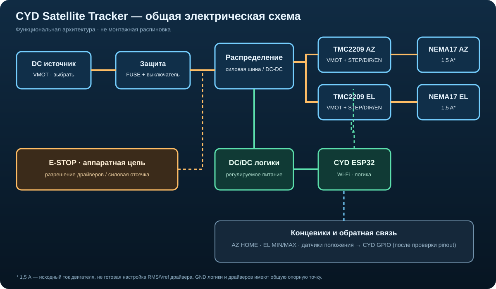

# Электрика CYD Satellite Tracker

[← К корню проекта](../../README.md) · [Механика ротатора →](../mechanics/README.md)

## Общая электрическая схема

Схема показывает функциональное разделение силового питания, питания логики, драйверов и аппаратной цепи безопасности. Это архитектура, а не монтажная схема с назначенными GPIO и номиналами.

## Состав системы
- CYD ESP32-2432S028R — контроллер и пользовательский интерфейс.
- 2 × TMC2209 — драйверы осей AZ и EL.
- 2 × NEMA17 — шаговые двигатели; исходный ток обмотки 1,5 А требует проверки по паспорту конкретного мотора.
- Концевики AZ HOME и EL MIN/MAX.
- Физическая аварийная остановка (E-STOP), аппаратно отключающая разрешение драйверов и/или силовое питание моторов.
- DC/DC-преобразователь для питания логики от выбранной шины.

## Архитектура питания
1. DC-источник → главный предохранитель → выключатель.
2. Отдельная защищённая ветвь VMOT для драйверов TMC2209.
3. Отдельная ветвь DC/DC → питание CYD в соответствии с требованиями платы.
4. Общая опорная точка GND для логики и драйверов; силовые токи моторов не должны идти через проводники питания CYD.
5. Конденсатор у VMOT каждого драйвера — согласно документации конкретного модуля; соблюдать полярность и допустимое напряжение.

## Управляющие сигналы
- CYD → каждый TMC2209: STEP, DIR, EN.
- UART — опционально, после проверки доступности GPIO и схемы конкретного модуля.
- Концевики — на входы с подтяжкой и программной фильтрацией; предпочтительны нормально-замкнутые контакты, чтобы обнаруживать обрыв.
- E-STOP — отдельная аппаратная цепь, не только программная кнопка интерфейса.

## Пока не назначено
- Точная модель блока питания и напряжение VMOT.
- Номиналы предохранителей, сечения проводов и параметры DC/DC.
- GPIO ESP32: сначала проверить ревизию CYD и занятые выводы дисплея, тачскрина, SD и подсветки.
- Конкретные модули TMC2209, Rsense и метод настройки тока.
- Разъёмы, длины кабелей, заземление и защита от перенапряжений.

## Безопасность и проверка
- Не подключать и не отключать моторы при включённом драйвере.
- Не питать моторы от выводов ESP32.
- Настроить ток по документации именно установленного TMC2209 и проверить нагрев двигателя и драйвера.
- До монтажа проверить полярность, сопротивление между VMOT и GND, целостность E-STOP и концевиков.
- Первый запуск выполнять без антенны, на ограниченном токе и с механически свободными осями.
- Сверить схему с даташитами компонентов и измерениями до подачи питания.

> **Внимание:** не использовать функциональную схему как основание для подключения до определения напряжений, номиналов защиты и pinout конкретной ревизии CYD.
