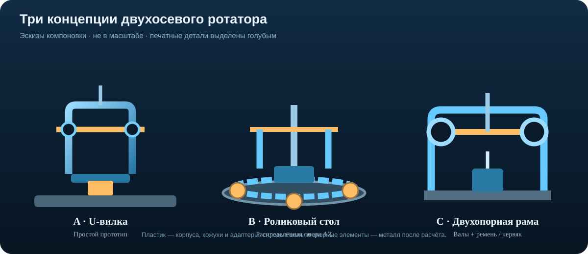
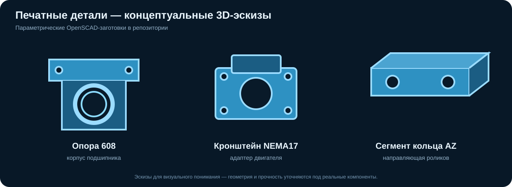

# Механика ротатора CYD Satellite Tracker

[← К корню проекта](../../README.md) · [Электрика →](../electrical/README.md)

Основная антенна проекта — VHF Crossed Yagi с круговой поляризацией, около 145 МГц. Требуемые оси: AZ 360° и EL 0–90°. Приводы проекта: 2 × NEMA17, исходный ток 1,5 А, драйверы TMC2209. Масса антенны, площадь парусности, момент двигателей и условия установки пока не подтверждены.

## Три концепции ротатора

### A — U-образная вилка (предпочтительна для первого прототипа)
- AZ-платформа на отдельном опорном подшипнике.
- U-вилка поддерживает ось элевации; антенна балансируется относительно неё.
- Печатные узлы: корпуса подшипников, держатели мотора, кожухи и кабельные направляющие.
- Валы, оси и мачтовые кронштейны — металлические.

### B — поворотный стол AZ с роликами
- Опорный круг на роликах распределяет нагрузку по окружности.
- Печатные узлы: держатели роликов, сегменты направляющего кольца, корпуса и крышки.
- Требует точной геометрии, защиты от воды и грязи и проверки боковой нагрузки.

### C — двухопорная рама
- Два разнесённых подшипниковых узла поддерживают ось EL.
- Привод — ременной или червячный, после расчёта момента и выбора передачи.
- Печатные узлы: корпуса подшипников, адаптеры мотора и натяжители ремня; вал — металл.

## Модели для 3D-печати

В репозитории находятся параметрические исходники OpenSCAD. Откройте файл в OpenSCAD, нажмите F6, затем File → Export → Export as STL.

- [Корпус опоры подшипника 608](../../mechanical/cad/bearing_block_608.scad)
- [Кронштейн двигателя NEMA17](../../mechanical/cad/nema17_bracket.scad)
- [Сегмент роликового кольца AZ](../../mechanical/cad/az_ring_segment.scad)

Это стартовые печатные заготовки для компоновки, а не законченные силовые детали и не готовый комплект ротатора. Перед печатью проверьте реальные размеры подшипников, мотора и крепежа, зазоры и отверстия. Сделайте пробную сборку.

### Рекомендации по печати
- Материал для прототипов: PETG; для наружных деталей предпочтительнее ASA или PA с учётом технологии печати.
- 4–6 периметров, 35–50% заполнения — только начальные параметры печати, не расчёт прочности.
- Ориентацию слоёв выбирайте так, чтобы рабочая нагрузка не раскрывала слои.
- Используйте металлические втулки/гайки и болты; не нагружайте пластик напрямую резьбой в критических соединениях.
- Не печатать из обычного PLA силовые валы, оси, мачтовые кронштейны и несущую вилку для уличной эксплуатации.

## Требования к конструкции
- AZ 360°: кабельный предел или токосъёмное кольцо.
- EL 0–90°: механические упоры и независимые концевики.
- Центр тяжести антенны располагать как можно ближе к оси EL.
- Рассчитать удерживающий момент, ускорение, люфт, резонанс, прогиб и ветровую нагрузку.
- Проверить устойчивость мачты и крепежа к расчётному порыву ветра.
- NEMA17 без редуктора нельзя считать достаточным для наружной антенны до расчёта.

## Что нужно измерить перед рабочими чертежами
1. Масса антенны вместе с кабелем и креплением.
2. Габариты и положение центра тяжести.
3. Диаметр и материал стрелы Crossed Yagi.
4. Точная модель NEMA17 и паспортный удерживающий момент.
5. Диаметр осей и доступные подшипники.
6. Высота установки и расчётная ветровая нагрузка.

> Все иллюстрации на этой странице — эскизы компоновки. Перед изготовлением несущих деталей необходимы расчёт прочности и проверка на реальных нагрузках.
