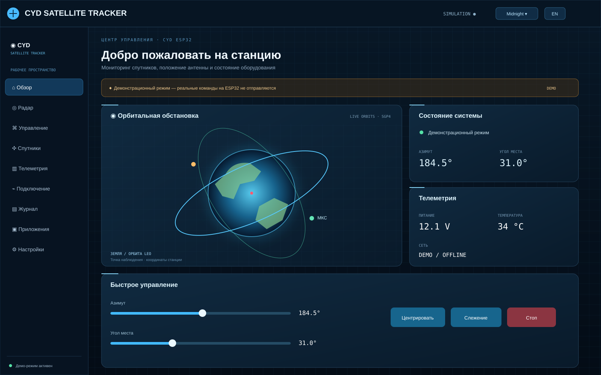
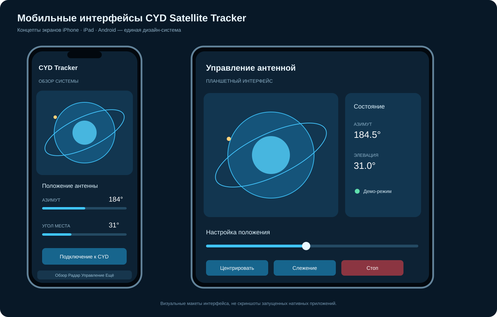

# Скриншоты и макеты интерфейсов CYD Satellite Tracker

[← К корню проекта](../../README.md)

Здесь собраны визуальные материалы веб-панели и концепты мобильных приложений для iPhone, iPad и Android.

## Веб-сайт

Макет показывает общую структуру: боковая навигация, орбитальная область, состояние системы, телеметрия и быстрые элементы управления.

## Мобильные приложения

Показаны адаптации интерфейса для компактного экрана телефона и планшета. Предполагается единая дизайн-система и одинаковая логика управления.

## Состояние реализации

| Платформа | Состояние |
|---|---|
| Веб-панель | Демонстрационная версия в репозитории |
| iPhone | Концепт интерфейса; нативное приложение ещё не собрано |
| iPad | Концепт интерфейса; нативное приложение ещё не собрано |
| Android | Концепт интерфейса; нативное приложение ещё не собрано |

> **Важно:** изображения на этой странице — специально подготовленные визуальные макеты, а не захваты экрана работающих приложений. Мобильные экраны иллюстрируют будущий Flutter-интерфейс. Данные на макетах демонстрационные; реального соединения с ESP32 и управления двигателями они не показывают.

## Файлы изображений
- [Макет веб-панели (SVG)](images/website-dashboard.svg)
- [Макеты мобильных интерфейсов (SVG)](images/mobile-apps.svg)

